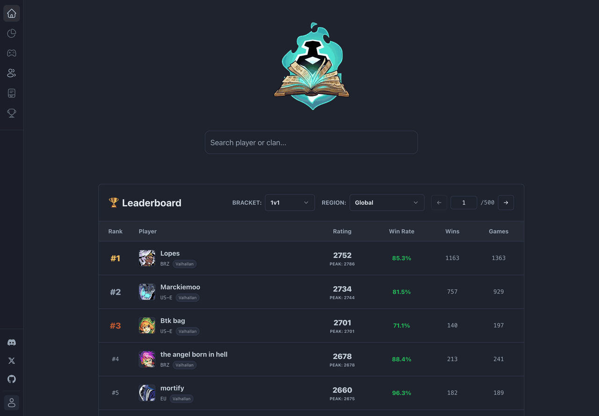

# Nick Tacke

Software engineer · TypeScript & backend systems · Netherlands 🇳🇱

<a href="https://brawltome.app"> brawltome.app</a>

## 👋 About

I build backend-heavy systems: typed API clients, data pipelines, and services that keep running when nobody's watching.

I also like taking undocumented things apart, like game replay formats, bytecode and admin panels, and turning them into tools other people can rely on.

<!-- stats:start -->

  
  
  
  

<!-- stats:end -->

## 🛠️ Stack

<table>
  <tr>
    <td><b>Languages</b></td>
    <td>  </td>
  </tr>
  <tr>
    <td><b>Backend &amp; data</b></td>
    <td>   </td>
  </tr>
  <tr>
    <td><b>Frontend &amp; apps</b></td>
    <td>   </td>
  </tr>
  <tr>
    <td><b>Infra &amp; tooling</b></td>
    <td>   </td>
  </tr>
</table>

## 📊 BrawlTome

A stats site for Brawlhalla, live at [brawltome.app](https://brawltome.app), tracking over **800,000 players** and serving close to **a million requests a month**.

Search any player or clan to see their ranked history, or watch who's queueing right now.

| For players | Under the hood |
| --- | --- |
| Player profiles with rating history and old names | Every API refresh runs through a job queue in Postgres |
| Leaderboards for every bracket and region | Jobs survive restarts, retry on failure and never double up |
| Clan pages and a live ranked queue | Stays inside the Brawlhalla API's rate limits |
| A Discord bot and a desktop overlay | One typed API serves the web app, bot and overlay |

Bun · Hono · tRPC · Next.js · Tauri · PostgreSQL · [source](https://github.com/NickTacke/brawltome)

## 🧰 Other projects

- [**brawlhalla-sim**](https://github.com/NickTacke/brawlhalla-sim): Brawlhalla's game logic, rebuilt from replays and bytecode
- [**txApi**](https://github.com/NickTacke/txApi): talk to txAdmin from any FiveM resource
- [**lightspeed-search**](https://github.com/NickTacke/lightspeed-search): AI product search and storefront widgets for Lightspeed webshops
- [**postnl-client**](https://github.com/NickTacke/postnl-client)  and [**lightspeed-client**](https://github.com/NickTacke/lightspeed-client) : typed TypeScript SDKs for shipping and webshop APIs

## 🕒 Recent activity

<!-- activity:start -->
- [brawltome#361](https://github.com/NickTacke/brawltome/pull/361) fix(infra): give next/image a writable cache so the header logo stops hanging 18 Oct
- [brawltome#358](https://github.com/NickTacke/brawltome/pull/358) ci: probe the public site from outside every five minutes 8 Oct
- [brawltome#357](https://github.com/NickTacke/brawltome/pull/357) fix(observability): don't page when a deep crawl waits out a Brawlhalla outage 8 Oct
- [brawltome#355](https://github.com/NickTacke/brawltome/pull/355) feat(ranked): show solo queue and fixed teams first seen by the deep crawl 8 Oct
- [brawltome#354](https://github.com/NickTacke/brawltome/pull/354) test(api): de-flake overlapping replicas runtime test 8 Oct
<!-- activity:end -->
